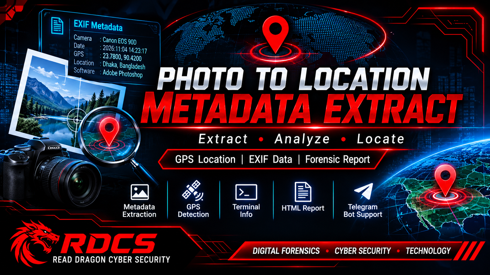

  

# RDCS PHOTO FORENSIC ENGINE

### READ DRAGON CYBER SECURITY
# PHOTO-LOCATION
RDCS PHOTO FORENSIC ENGINE

READ DRAGON CYBER SECURITY

Photo Metadata Extraction | GPS Location Detection | Telegram HTML Reporting

A terminal-based photo forensic tool designed to extract available metadata from image files, detect embedded GPS coordinates, display location information in the terminal, and generate a detailed HTML report delivered directly to your Telegram bot.

---

FEATURES

- Extract available photo metadata.
- Detect embedded GPS coordinates.
- Display extracted information in the terminal.
- Show GPS location information when available.
- Generate a detailed HTML report containing photo metadata.
- Automatically send the HTML report to your configured Telegram bot.
- Secure Telegram Bot Token storage with hidden terminal input.
- Test Telegram Bot connectivity.

REQUIREMENTS

- Python 3
- Termux or Linux Terminal
- Internet connection (for Telegram reporting)
- Telegram Bot Token
- Telegram Chat ID

INSTALLATION

Clone the repository:

git clone https://github.com/RDCD-SOCIETY/PHOTO-LOCATION.git

Enter the project directory:

cd PHOTO-LOCATION

Install dependencies:

pip install -r requirements.txt

Run the tool:

python PE.py

Replace "main.py" with your actual Python filename if different.

TELEGRAM BOT CONFIGURATION

When the tool starts, open:

[2] TELEGRAM BOT SETTINGS

1. Set / Change Bot Token

- Select "1. Set / Change Bot Token".
- Paste your Telegram Bot Token.
- Press Enter to save it.

Security: The Bot Token is hidden in the terminal while entering it, helping prevent accidental exposure on screen.

2. Set / Change Chat ID

- Select "2. Set / Change Chat ID".
- Enter your Telegram Chat ID.
- Press Enter to save it.

3. Test Bot Connection

Select:

"3. Test Bot Connection"

Use this option to check whether your Telegram bot connection is working correctly.

Return to Main Menu

After completing the Telegram configuration, select:

"5. Back"

HOW TO USE

SINGLE PHOTO ANALYSIS

1. Select "[1] SINGLE PHOTO ANALYSIS".
2. Open your target photo in your phone's gallery or file manager.
3. Open the photo details and copy its File Path.
4. Paste the copied file path into the terminal.
5. Press Enter to start the analysis.

The tool will extract the available metadata and display the information in the terminal.

TELEGRAM HTML REPORT

After analysis, the tool will ask:

"Send HTML report to Telegram? (Y/n)"

- Type "y" and press Enter to send the detailed HTML report to your configured Telegram bot.
- The HTML file contains the available extracted photo metadata.

GPS LOCATION INFORMATION

If the original image contains embedded GPS metadata, the tool can extract the available GPS coordinates and display location information.

Important: Not every photograph contains GPS metadata. Location information cannot be guaranteed when GPS data is missing or has been removed.

SECURITY & PRIVACY

- Keep your Telegram Bot Token private.
- Do not upload personal photos without permission.
- Only analyze images you own or are authorized to examine.
- GPS information may reveal sensitive location details.
- Protect generated HTML reports because they may contain private metadata.

DEVELOPER

RDCS — READ DRAGON CYBER SECURITY

Cyber Security | Digital Forensics | Technology

---

Developed for educational and authorized digital forensic analysis.
